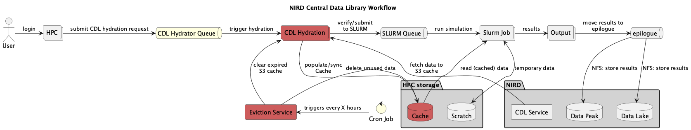

(nird-cdl-cache-hydrator)=

#  Using CDL datasets on HPCs (CDL cache hydrator)

The CDL service allows users to store datasets to be shared within and across projects on NIRD as a centralized repository. 

The CDL Cache Hydrator functionality in CDL maintains a local cache of datasets on the HPC system's local filesystem by pulling the needed datasets from NIRD through S3. Cached data can be rehydrated at any time. Also, the service is envisioned so that data not being accessed for the set retention time will be automatically evicted from the cache.

```{admonition} At a glance
:class: tip

- **What it does:** copies CDL data from NIRD to `/cluster/cache/<service>/` on the HPC system.
- **How you use it:** put a small request file (`.conf`) in `/cluster/cache/conf/`.
- **What you get:** a **read-only** copy of the data for your jobs.
- **How long it stays:** until nobody has used it for **45 days(currently)**. After that it is removed, and you can request it again.
- **Before you can use it:** the CDL Project Leader must enable it for the HPC system you use.
- **Please:** request only what you need. The cache is shared with everyone on the system.
```

## How it works 

1. The master copy of the data is kept in a CDL S3 bucket on NIRD.
2. You place a request file (`.conf`) in `/cluster/cache/conf/` on the HPC system.
3. The hydrator reads your request, downloads the data from NIRD over S3, and saves it in
   `/cluster/cache/<service>/`.
4. Your jobs read the data from there. The cache is **read-only**.
5. Data that nobody has used for **45 days** is removed from the cache. The master copy on NIRD
   is not affected, and you can request the data again at any time.

The cache is on a disk **shared by all users** of the HPC system, so request only what you need.

(cdl-hydrator-setup)=

## For Project Leaders: enable the hydrator

The hydrator is **not** turned on automatically. As the Project Leader of a CDL project, you decide
which data can be cached and where. Either specify the s3 bucket and access policy and HPC systems where the hydrator should be available during the allocation process or contact the support afterwords with following information.

1. **Your CDL project**, for example `NS16003B`.
2. **The S3 bucket to cache.** Request an S3 bucket for your CDL project, named
   `cdl-nsxxxxb-<bucketname>` (lowercase), for example `cdl-ns16003b-wrf`.
   The hydrator can only copy data that is in an S3 bucket.
3. **The HPC systems** where the data should be available: Olivia, Betzy and/or Saga.

When the setup is done, the folder `/cluster/cache/<service>/` appears on each system you asked for.

### CDL project registered on NIRD
Each CDL project has its master copy on NIRD Data Lake which is accessible via both POSIX and S3 protocols (NFS access is also available).

These projects are called with the following naming format `NSxxxxB` (e.g. NS16003B). Each project is available read-only to any POSIX user having access to NIRD and users having access to the S3 endpoint on NIRD, https://s3.nird.sigma2.no.

Each CDL project has a curresponding S3 bucket following the naming format `cdl-nsxxxxb-service`, e.g. `cdl-ns16003b-wrf`. Note that the bucket name uses lowercase and the project name must match exactly even though it is in lowercase. 

(cdl-hydrator-quick-start)=

## For users: get your data in 6 steps

**Step 1. Check that the hydrator is enabled on your system.**

```console
$ ls /cluster/cache/
```

If you don't see your bucket name/service name (for example `wrf`), the hydrator isn't enabled on this system.
Request the CDL Project Leader to enable it {ref}`cdl-hydrator-setup` .

**Step 2. Copy the template.**

```console
$ cp /cluster/cache/conf/00-cdl-hydrator.template ~/<servicename>-<username>>-001.conf
```

**Step 3. Edit the file** to say which data you need. See {ref}`cdl-hydrator-request-file`.

**Step 4. Send the request** by copying the file into the request folder.

```console
$ cp ~/wrf-nn9999k-case01.conf /cluster/cache/conf/
```

**Step 5. Check that the data has arrived** before you submit your job.

Eg: 

```console
$ cat /cluster/cache/conf/<servicename>-<username>>-001.json   # status and log
$ ls /cluster/cache/<servicename>>/          # the data itself
```

**Step 6. Run your job** using the cached data. Use the cache path correctly in your job script.

The cache is managed automatically by the cdl_cache_cleanup process, which evicts data that has not been accessed within the current retention period

### Storing results

When the job completes, copy or stage your results to the appropriate project storage. The recommended destination is uour project area on NIRD Data Peak or NIRD Data Lake.

(cdl-hydrator-request-file)=

## Writing a request file

### Name it correctly

Config file names must follow a strict convention or the hydrator will silently ignore them:
- The name **must** start with the CDL service name, (for example `wrf` or `noresm`),
- This **must** be followed by a descriptive identifier such as your project name, or  username, or optionally  sync job number.
- The file **must** end with the `.conf` extension. Files with any other extension will be ignored.

* **Correct:** `wrf-case-01.conf` or `noresm-username-dataname.conf`
* **Incorrect:** `my-data.conf` or `wrf-project-01.txt` - the CDL Hydrator will ignore these files

### Choose what to cache

You can ask for a **whole folder** or for **specific files**. Use one of these options in each request
file, not both.

#### Option A: a whole folder

Use this when you need everything in one folder. Subfolders are included.

Example Config (`wrf-case-01.conf`):
```ini
[SYNC]
s3_endpoint = s3://open-data-bucket/
target_path = 2026/march/observations/*
# Optional tuning parameters:
nr_workers = 2
log_level = info
```
A TOML template file, called `00-cdl-hydrator.template` is created for convenience. 

The data keeps its folder structure, so it ends up in `/cluster/cache/wrf/2026/march/observations/`.

#### Option B: a few specific files

For experiments needing a defined set of files, spread across different directories, where pulling whole trees would be wasteful. In such case, the specific file path can be specified as follows in the `conf` file, as shown in the example below. In this case `conf` file must contain a [FILES] section.

Example Config (`wrf-case-02.conf`):

```ini
[SYNC]
s3_endpoint = s3://open-data-bucket/
# Optional tuning parameters:
nr_workers = 2
log_level = info

[FILES]
paths =
    geog/topo_30s/const_2t.dat
    wps/2026/03/met_em.d01.2026-03-01_00.nc
```
When 100+ files, the recommended way is to create plain text file containing the file path and use that in the `conf` to pull the data.

Example Config (`wrf-case-03.conf`):

```ini
[SYNC]
s3_endpoint = s3://open-data-bucket/
# Optional tuning parameters:
nr_workers = 2
log_level = info

[FILES]
manifest = /cluster/projects/nn9999k/case-01.filelist
```
`manifest` must be in absolute path. The filelist `case-01.filelist` is the plain text, one object key per line, relative to s3_bucket. Blank lines and `#` comments are ignored.
An example line in  `case-01.filelist` is given below.

> geog/topo_30s/const_2t.dat

#### Field reference:

- s3_endpoint (required): The URL of the CDL project S3 bucket. 
- target_path (required for Mode 1): The path to synchronise. Glob patterns are supported (e.g. * matches all files in that directory).
- nr_workers (optional): Number of parallel download workers. Default is 1. Increase for large datasets to speed up the transfer. Upper limit 512
- log_level (optional): Logging verbosity. Accepted values: info, warning, error. Default is info.

### Verifying cached data

After placing a config file in `/cluster/cache/conf`, the hydrator will detect it and begin downloading the requested data. To confirm that data has been successfully cached before submitting your job:
- Check the cache directory directly ls /cluster/cache/<service>/
- You can check the `<your-config.filename>.json` file with log info

## Using cached data in your job

Read input from the cache. Write output to scratch. Eg: below : 

```bash
#!/bin/bash
#SBATCH --account=nn9999k
#SBATCH --job-name=wrf-case01
#SBATCH --time=12:00:00

INPUT=/cluster/cache/wrf/2026/march/observations   # read-only cache
OUTPUT=/cluster/work/projects/nn9999k/wrf-case01   # scratch  storage

mkdir -p "$OUTPUT"
# ... run your model, reading from $INPUT and writing to $OUTPUT ...
```

When the job is done, copy any results you want to keep to your project storage, for example
[NIRD Data Peak](nird_dp.md).

(cdl-hydrator-fair-use)=

## Please use the cache fairly

The cache is on a disk that **everyone** on the HPC system shares. Very large or repeated requests fill
it up and slow it down for all users.

| ✅ Please do | ❌ Please don't |
|---|---|
| Ask only for the folders or files your jobs need | Cache the whole bucket "just in case" |
| Check whether the data is already cached first | Send the same request again and again |
| Send requests **before** you submit jobs | Put requests inside job scripts |
| Keep `nr_workers` low | Use the cache as scratch or general storage |


## When the data on NIRD changes

**Updating the data on CDL**: The project leader and any designated member can add data and manage the data in the CDL project. All other NIRD users have read-only access either through file storage access or object storage access. 
The master copy can be updated either using regular POSIX commands on the NIRD login nodes (`login.nird.sigma2.no`) via SSH access, or using S3 account with read-write role, from the same `https://s3.nird.sigma2.no` endpoint.

**Getting the new version into the cache.** The cache does **not** update itself. To fetch the new
version, copy your `.conf` file into `/cluster/cache/conf/` again, or create a new one.

## Frequently asked questions

### Getting started

**What is the difference between CDL and the cache?**
CDL on NIRD holds the **master copy**, the one that is kept and managed. The cache is a **temporary
local copy** on an HPC system, made only so your jobs can read the data faster.

**Who can turn on the hydrator?**
System admin enables the hydrator following the request of the Project Leader of the CDL project. They request an S3 bucket and choose which HPC systems
get the cache.

**Which HPC systems support it?**
Olivia, Betzy and Saga. For each bucket, the cache is only available on the systems the Project Leader
asked for. Run `ls /cluster/cache/` to check.

**Do I have to be a member of the CDL project?**
No. When the hydrator is enabled on a system, all users of that system can read the cached data and
request data from the bucket.

**Do I need an S3 account to use the cache?**
No. The hydrator fetches the data for you. You only work with files on the HPC system.

### Requesting data

**How long does it take before my data is ready?**
It depends on how much data you ask for. Small requests are usually quick, large ones take longer.
Check the `.json` file and the cache folder before you submit your job.

**Can I ask for the whole bucket?**
Only if your jobs really need all of it. Large requests affect everyone on the system.
Ask for specific folders or files instead.

**Someone else already requested the same data. Do I need to request it too?**
No. If the data is already in `/cluster/cache/<servicename>/`, you can use it right away.

**My request file is ignored. Why?**
Most likely the name is wrong. Check the naming convention. 

**What should I set `nr_workers` to?**
Leave it at the default (`2`) for small requests. For large transfers, a moderate value like `4` or `8`
is usually enough.

### Using and keeping data

**Can I write to the cache?**
No. It is read-only. Write your results to your own project area.

**What happens after 45 days?**
Data that nobody has used for 45 days is removed from the cache. The master copy on NIRD is not
affected, and you can request the data again at any time. Please note that the current retention time is 45 days, it can change in the future. 

**The data on NIRD was updated. Do I get the new version automatically?**
No. Copy your `.conf` file into `/cluster/cache/conf/` again, or create a new one.

**Should I delete my request file?**
Yes. Delete it from `/cluster/cache/conf/` when you no longer need it, to keep the shared folder tidy.

### Getting help

**Who do I contact if something goes wrong?**
Contact [support](../../getting_help/support_line.md). Include the name of your request file and the
contents of its `.json` file.


## CDL caching diagram

